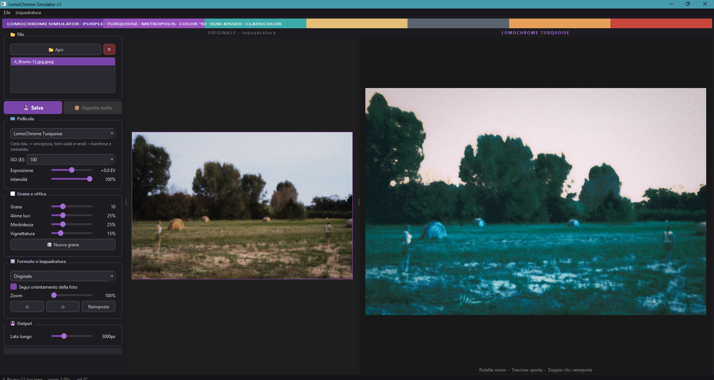
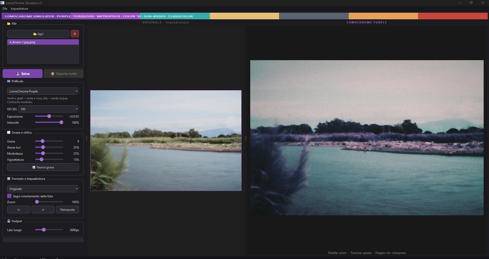

# LomoChrome Simulator

**IT** · [EN](#english)

Simulatore desktop delle pellicole LomoChrome e Lomography Color, scritto in Python/PyQt6. Le pellicole a colori "invertiti" (Purple, Turquoise, Metropolis) sono ricostruite da misure, non da filtri a occhio.



## Pellicole

| Pellicola | Effetto | Modello |
|---|---|---|
| **LomoChrome Purple** | verdi e gialli → viola e rosa, blu → verde acqua; contrasto morbido | misurato |
| **LomoChrome Turquoise** | cielo blu → oro/pesca, toni caldi e verdi → turchese e smeraldo | misurato |
| **LomoChrome Metropolis** | colori smorzati, contrasto deciso, toni freddi e metallici | misurato, vincolato su oggetti noti |
| **Color '92** | pastello anni '90, neri sollevati, luci compresse, grana evidente | statistico |
| **Color '92 Sun-kissed** | dorata, gialli e arancio caldi, più contrastata | statistico |
| **Classicolor** | colori naturali e vividi, pelle calda, rossi pieni | statistico |

## Come sono costruiti i modelli

- **Purple, Turquoise, Metropolis.** Partono da coppie di colori digitale→pellicola: una tavola ColorChecker a 24 patch fotografata su pellicola e la stessa scena ripresa in digitale e su pellicola, con i fotogrammi allineati al pixel. Su queste coppie viene stimata una matrice di scambio dei canali, che riproduce gli strati sensibili invertiti dell'emulsione, insieme a curve tonali per canale con esposizione separata per ogni scena. Sulle patch si applica poi una correzione locale RBF.
- **Color '92, Sun-kissed, Classicolor.** È un'impronta statistica: dominante per fascia tonale, saturazione e contrasto misurati su 15–32 scansioni pubblicate da Lomography per ciascuna pellicola.
- **Risposta all'ISO** (100 / 200 / 400) per le LomoChrome: a ISO 400 la Turquoise vira più verso il pesca, tarata su un cielo reale.



## Funzioni

- Esposizione (EV) e intensità dell'effetto
- Grana, alone sulle luci, morbidezza, vignettatura; pulsante "nuova grana"
- Formati: originale, 35 mm, 6×4,5, 6×6, 6×7, mezzo formato, panoramico
- Inquadratura interattiva: rotella = zoom, trascina = sposta, doppio clic = reimposta; rotazione
- Esportazione singola o in blocco, lato lungo regolabile

## Installazione

Richiede Python 3.9+.

```bash
pip install -r requirements.txt
python lomochrome_sim.py
```

Funziona su Windows e Linux.

## Vedi anche

[polaroid-simulator](https://github.com/Dmitrij-Anatolievic/polaroid-simulator): simulatore Polaroid Reclaimed / Duochrome con curve misurate.

## Autore

**Dmitrij Musella**, fotografo sperimentale e ricercatore indipendente, Napoli.
ORCID [0009-0004-4105-837X](https://orcid.org/0009-0004-4105-837X)

LomoChrome e Lomography sono marchi di Lomographische AG. Questo progetto è indipendente e non è affiliato né approvato da Lomography.

## Licenza

[MIT](LICENSE)

---

## English

Desktop simulator of LomoChrome and Lomography Color films, written in Python/PyQt6.

**Films:** LomoChrome Purple, Turquoise and Metropolis (measured models), plus Color '92, Color '92 Sun-kissed and Classicolor (statistical fingerprints).

**Method:** the false-colour films start from digital→film colour pairs, taken from a 24-patch ColorChecker shot on film and from the same scenes shot digitally and on film, with the frames aligned to the pixel. These pairs fit a channel-swap matrix that mimics the emulsion's inverted sensitive layers, plus per-channel tone curves with per-scene exposure, followed by a local RBF correction on the patches. The Lomography Color films use per-tone-band casts, saturation and contrast measured on 15–32 published scans per film. LomoChrome films also respond to ISO 100/200/400.

**Features:** exposure and strength, grain, halation, softness, vignetting; formats (35 mm, 6×4.5, 6×6, 6×7, half-frame, panoramic); interactive framing; single and batch export.

**Install:** `pip install -r requirements.txt` then `python lomochrome_sim.py` (Python 3.9+, Windows/Linux).

LomoChrome and Lomography are trademarks of Lomographische AG. This is an independent project, not affiliated with or endorsed by Lomography.

License: MIT · Author: Dmitrij Musella
